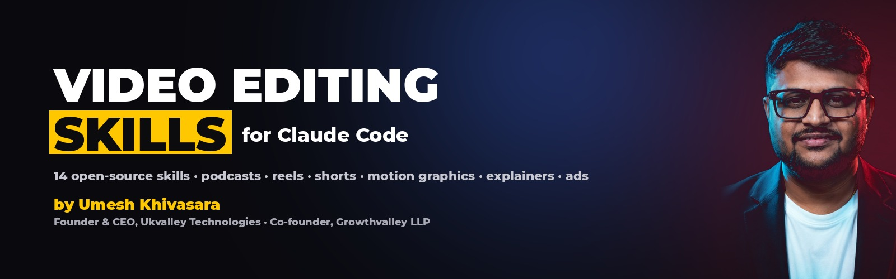

<!-- ============================================================
     LANDING PAGE — replace every {{PLACEHOLDER}} and drop your images into profile/.
     Search for "{{" to find them all.
     ============================================================ -->

<p align="center">
  
</p>

<h1 align="center">Video Editing Skills for Claude</h1>

<p align="center">
  <b>14 production-tested skills that turn Claude Code into a full video studio:</b><br>
  podcasts · reels · shorts · motion graphics · product explainers · courses · YouTube · ad creatives · thumbnails
</p>

<p align="center">
  <a href="{{WEBSITE_URL}}"></a>
  <a href="{{LINKEDIN_URL}}"></a>
  <a href="{{INSTAGRAM_URL}}"></a>
  <a href="{{YOUTUBE_URL}}"></a>
  <a href="{{BOOKING_URL}}"></a>
</p>

<p align="center">
  <a href="LICENSE"></a>
  
  
</p>

---

## 👋 Built by {{YOUR_NAME}}

<table>
<tr>
<td width="220" valign="top"></td>
<td valign="top">

**{{YOUR_NAME}}** — {{ONE_LINE_TITLE}}

{{SHORT_BIO_2_TO_4_SENTENCES — who you are, what you've built, who you help.}}

- 🎬 {{PROOF_POINT_1 — e.g. "300+ videos edited for brands across India"}}
- 🚀 {{PROOF_POINT_2}}
- 🎤 {{PROOF_POINT_3}}

📩 {{CONTACT_EMAIL_OR_WHATSAPP}}

</td>
</tr>
</table>

## 🏢 My companies

| | Company | What we do |
|---|---|---|
| <picture><source media="(prefers-color-scheme: dark)" srcset="profile/logos/growth-valley-white.png"></picture> | **[Growth Valley](https://growthvalley.online)** | Don't just run ads. Build the system that converts them. |
|  | **[Sales Mantra]({{COMPANY_2_URL}})** | {{COMPANY_2_ONE_LINER}} |
|  | **[Ukvalley]({{COMPANY_3_URL}})** | {{COMPANY_3_ONE_LINER}} |

> Want these workflows done for you? **[Book a call]({{BOOKING_URL}})** — or star ⭐ the repo to follow updates.

---

## 🎥 What these skills make

<!-- Put 3–6 short demo GIFs/MP4 thumbnails in profile/ and link them here. Showing output is what gets stars. -->
| Podcast recut | Reel with motion graphics | Product explainer |
|---|---|---|
|  |  |  |

## 🧰 The skills

Start every job with **`video-studio`** — it reads the request and routes it to the right specialist.

| Skill | What it does |
|---|---|
| [`video-studio`](skills/video-studio) | Hub: picks the right skill, shared rules, shared scripts (ElevenLabs TTS / Scribe / voice isolation, cut-list renderer, face-follow 9:16 reframing, transcript tools) |
| [`video-editor-pro`](skills/video-editor-pro) | The craft layer: cutting, pacing, transitions, sound design, beat sync, grading, captions, delivery specs and QC |
| [`hinglish-talking-head-reel`](skills/hinglish-talking-head-reel) | Talking-head → 9:16 reel: retake removal, tight pauses, Roman Hinglish karaoke captions, word-synced graphics, SFX, grade |
| [`podcast-editor`](skills/podcast-editor) | Podcast → YouTube episode: voice isolation, automatic filler/stutter/false-start cuts with a reviewable report, auto multicam, cold open, chapters |
| [`long-to-shorts`](skills/long-to-shorts) | Long video → viral clips: transcript-scored candidates, Apple-Vision face-follow reframing, captions, hook titles |
| [`motion-graphics`](skills/motion-graphics) | Logo stings, kinetic typography, animated data, lower-third packs, transparent overlay packs — code-rendered, crisp |
| [`product-explainer-video`](skills/product-explainer-video) | 2–3 min SaaS explainers and 30 s ads (YouTube, Reels, TV) with ElevenLabs VO and word-synced scenes, multi-language |
| [`course-video`](skills/course-video) | Slides/PDF → narrated lesson, each part revealed on its spoken cue |
| [`youtube-longform`](skills/youtube-longform) | Talking head + screen recording: cursor zooms, PiP, retention pacing, chapters, end screen |
| [`ad-creative-variants`](skills/ad-creative-variants) | Hooks × bodies × CTAs → many Meta/YouTube ad creatives in 9:16 / 4:5 / 1:1 / 16:9 with a test plan |
| [`cinematic-beat-reel`](skills/cinematic-beat-reel) · [`cinematic-reel`](skills/cinematic-reel) | Music-only cinematic reels cut on the beat: slow-mo, bloom, flashes on the drop, title cards |
| [`thumbnail-designer`](skills/thumbnail-designer) | YouTube thumbnails (A/B variants) and Reels covers with face-aware layout |
| [`video-shotcraft`](https://github.com/Vincentwei1021/video-shotcraft) ↗ | Not included — an excellent third-party skill (Apache-2.0) for cinematic web-product promos with Remotion. Install it from its own repo. |

## ⚡ Install

Requirements: macOS, [Claude Code](https://claude.com/claude-code), Homebrew.

```bash
git clone https://github.com/{{GITHUB_USERNAME}}/{{REPO_NAME}}.git
cd {{REPO_NAME}}
./setup.sh            # installs ffmpeg-full, numpy, pillow, whisper-cpp; links the skills; creates the studio
```

`setup.sh` links every skill into `~/.claude/skills/`, creates a studio folder at `~/video-editing` (override with `VIDEO_STUDIO=/path ./setup.sh`),
downloads the open-source fonts and generates the royalty-free SFX and music library. Optional: put `ELEVENLABS_API_KEY=...` in
`~/video-editing/.env` for voice-over, Scribe transcripts and voice isolation.

Then open Claude Code in the studio and just ask:

```text
New project from inbox: edit this podcast episode, remove fillers, and cut 5 shorts from it.
```

## 🗂 How the studio is organised

```
~/video-editing/
├── inbox/            drop new footage here
├── new-project.sh    ./new-project.sh <name> → projects/YYYY-MM-DD_<name>/{raw,edit,work,exports,notes.md}
├── assets/           shared: brand/, fonts/, sfx/, music/, luts/, broll/, overlays/
├── toolkit/          shared graphics engines (reel, podcast, product, explainer) + SFX/music generators
└── projects/         one folder per video; raw/ is never modified, every version is logged in notes.md
```

## 🤝 Contributing

Issues and PRs are welcome — new skills, better SFX, fixes for other platforms. See [CONTRIBUTING.md](CONTRIBUTING.md).

## 📜 License

Code and skills: [Apache-2.0](LICENSE) — free to use, modify and share, keeping the [NOTICE](NOTICE) attribution.
Photos, logos and brand names in `profile/` are **not** covered by the license — see [BRAND-ASSETS.md](BRAND-ASSETS.md).

<p align="center">Made with 🎬 by <a href="{{WEBSITE_URL}}">{{YOUR_NAME}}</a> · If this saved you hours, give it a ⭐</p>
